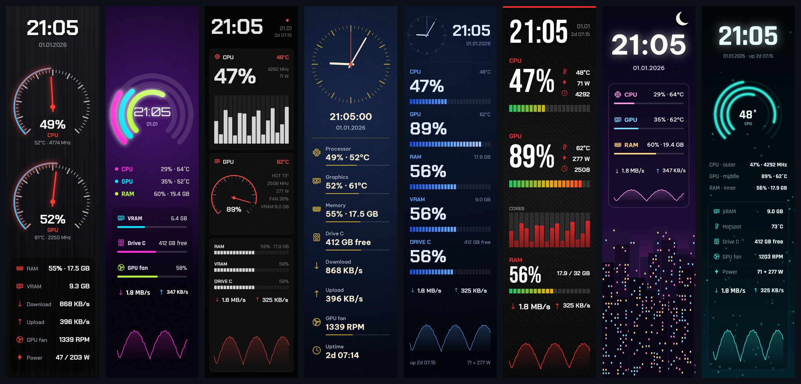
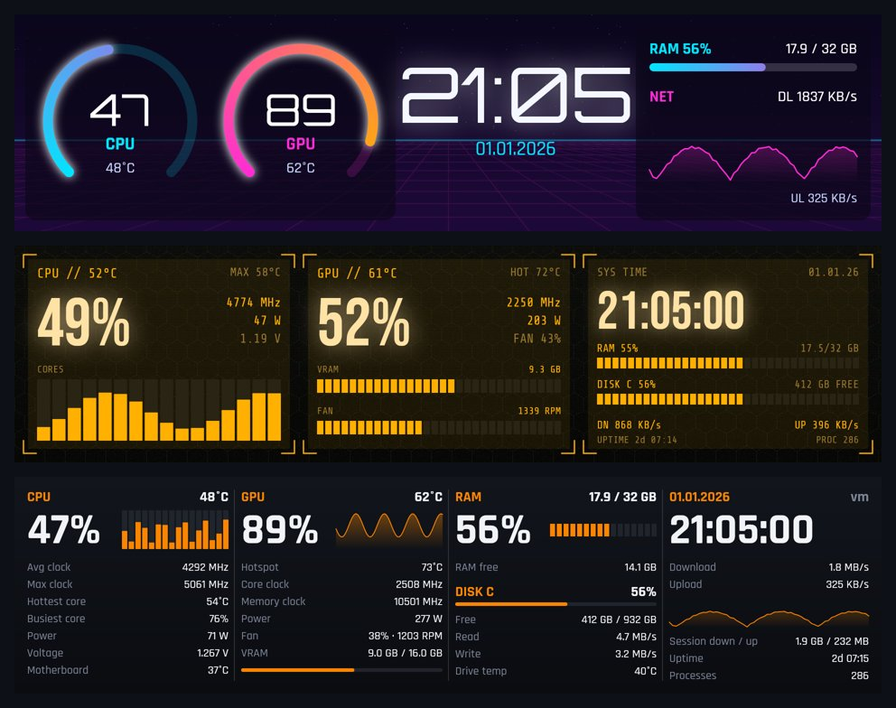

# HUD Buddy

Free Windows app that puts live system stats on **8.8" USB screens**.

## Download

Get the latest **HudBuddy-x.y.z-win-x64.zip** from [**Releases**](../../releases), unzip it anywhere and run
`HudBuddy.exe`. No installer, no .NET needed.

Windows may say *"Windows protected your PC"* because the app is not code-signed: click **More info → Run anyway**.

## Supported screens

| Screen | Notes |
|---|---|
| **TURZX 8.8"** (1920×480, USB `1CBE:0088`) | Close the TURZX app first |
| **Lian Li Universal Screen 8.8"** (USB `1CBE:A088`, LCD mode) | Close L-Connect 3 first; if the screen is in Windows monitor mode, switch it back to LCD mode in L-Connect |

Only one program can drive the screen at a time: if SignalRGB lists the screen, turn it off there.

## Features

- **40+ themes**, vertical and horizontal, with a live preview using your PC's readings.
- **40+ readings**: CPU load per core, temperatures, clocks and power; GPU load, hotspot, VRAM and fan; RAM;
  drive space and read/write; network; uptime; and any sensor LibreHardwareMonitor can read.
- **Customize** any theme: choose what each gauge or text shows, change text, size and colours, hide elements.
- **Theme from photo**: pick a picture, drag a screen-shaped frame over the part you want, add a stats layout.
- **More themes**: copy theme folders or `.zip` files into the `skins` folder next to `HudBuddy.exe`. They show up
  by themselves.
- Brightness, rotate 180°, start with Windows, tray icon, reconnects when the cable is re-plugged.

CPU temperature, CPU power and motherboard fans need **Run as administrator**.

## Questions and bugs

Open an [issue](../../issues) with your screen model, Windows version and what you saw.

---

HUD Buddy is free to use. It is not affiliated with TURZX or Lian Li. Third-party components and their licenses are
listed in `THIRD_PARTY_NOTICES.md` inside the download.
